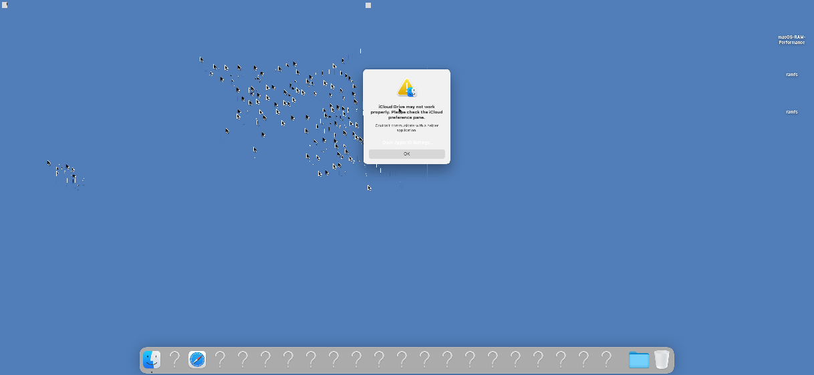

[English](README.md) | **한국어**

# macos-z3q

**Galaxy S20 Ultra (SM-G988N / Snapdragon 865 / SM8250)에서 macOS Ventura 13.4를 실행한 실험적 포트입니다.** 기존 HackiOS/Samsung 포팅을 바탕으로 실제 Apple 사용자 영역의 Finder와 Dock까지 RAM에서 실행했습니다. 완성된 설치 ROM이나 일상 사용 가능한 macOS 제품은 아닙니다.

Experimental native macOS Ventura bring-up for the Snapdragon Galaxy S20 Ultra. **Work in progress: touch alignment and cursor trails are unresolved, and the desktop still uses software compositing.**

## 현재 상태

| 기능 | 확인 결과 |
|---|---|
| macOS | 13.4 / 22F66, 읽기 전용 RAM 루트와 휘발성 데이터 영역 |
| 화면 | 실기 Finder/Dock 출력, 가로 2436×1125 시험 |
| CPU | 큰 코어 4개, 약 2.42GHz / 프라임 2.84GHz 전환 확인 |
| CPU 제어 | 부하 기반 유휴/부스트 전환·온도 센서 읽기 확인. 장기 전력·열 제어 검증은 미완료 |
| Adreno 650 | 실제 GLES 셰이더·픽셀 읽기 검증 통과 |
| 바탕화면 GPU 가속 | Metal/CoreAnimation 연동 미완료, 소프트웨어 합성 |
| 터치 | 실제 패널 입력 수신. 위치 오차·커서 잔상 해결 중 |
| 안정성 | 가로 부팅 중 WindowServer 재시작 관측. 설치·충전·Wi-Fi·오디오·절전 검증 미완료 |

CPU 커널 정수 루프는 167→563, 약 3.37배였습니다. 이는 전체 UI 속도 배율이 아닙니다. 1125×2436 오프스크린 텍스처 한 층 합성은 최소 769µs였으며 화면 FPS를 뜻하지 않습니다. 수치는 [RESULTS.json](docs/RESULTS.json)에 정리했습니다.

### 실기 프레임 캡처 — 알려진 문제 포함



실제 휴대폰에서 화면 출력 직전 IOSurface를 읽어 만든 이미지입니다. 패널 사진은 아니며, 이 캡처에는 수정 중인 커서 잔상이 보입니다.

## 저장소 구성

- `patches/`: 고정된 Apple XNU 8796.121.2에 적용하는 수정 패치
- `kernel-overlay/`: Samsung/HackiOS 하드웨어 지원 및 macOS 호환 소스
- `userland/`: 터치 브리지와 CPU/GPU 검증 프로그램 소스
- `tools/`: 소스 준비·커널 빌드·RAM 전송·APFS 생성·프레임 디코더
- `compat/standalone/`: 독립 Mach-O용 실험적 PAC 호환 도구
- `manifests/`: 소스 검증 해시와 별도로 필요한 입력 목록
- `tests/`: 좌표 변환과 회전 코드 검사

## 시작하기

이 코드는 **SM-G988N Snapdragon 기기와 기존 호환 xnuloader 환경**을 기준으로 시험했습니다. Exynos나 다른 모델의 동작을 의미하지 않습니다. Apple 시스템 이미지·dyld 캐시·SDK·벤더 펌웨어·휴대폰 파티션 백업은 포함하지 않습니다.

[BUILD.md](docs/BUILD.md)에서 소스 준비와 별도 입력을 확인하고, [RAM-BOOT.md](docs/RAM-BOOT.md)에서 시험 경로를 확인하세요. macOS RAM 루트를 처음부터 재현하는 전체 자동화는 아직 제공하지 않습니다. 기존 SDK와 준비된 루트가 필요한 연구용 소스 공개입니다.

```sh
sh tests/run.sh
```

현재 포트의 보안 모델은 정품 Mac과 다르며, PAC 변환과 최소 호환 서비스 등 연구용 변경이 포함됩니다.

## 크레딧·라이선스

Apple XNU, [G986N-iOS](https://github.com/leh0726/G986N-iOS), OOSEX GANG의 HackiOS, UniXNU-zeta 및 기존 공개 구현을 기반으로 합니다. 기존 하드웨어 포팅 전체를 이 프로젝트의 신규 작업으로 주장하지 않습니다. [THIRD_PARTY.md](THIRD_PARTY.md)와 파일별 라이선스를 확인하세요.
