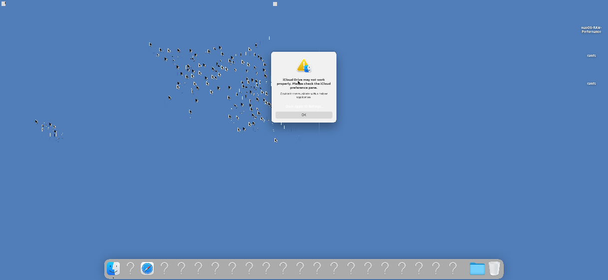

[한국어](README.ko.md)

# macos-z3q

**An experimental native macOS Ventura 13.4 port for the Galaxy S20 Ultra (SM-G988N / Snapdragon 865 / SM8250).** Built on the existing HackiOS/Samsung platform work, it runs the actual Apple userspace, including Finder and Dock, from RAM. This is a research source release, not an installable ROM or a daily-use macOS system.

**Work in progress:** touch alignment and cursor trails remain unresolved, and the desktop still uses software compositing.

## Current status

| Feature | Observed result |
|---|---|
| macOS | Ventura 13.4 / 22F66, with a read-only RAM root and volatile data area |
| Display | Finder and Dock observed on the physical device; 2436×1125 landscape trials |
| CPU | Four big cores active; transitions to about 2.42GHz on the big cluster and 2.84GHz on the prime core confirmed |
| CPU control | Load-based idle/boost transitions and temperature sensor reads confirmed; long-term power and thermal validation incomplete |
| Adreno 650 | Real GLES shader execution and pixel readback verified |
| Desktop GPU acceleration | Metal/CoreAnimation integration incomplete; software compositing |
| Touch | Physical panel input received; alignment and cursor trails under investigation |
| Stability | A WindowServer restart occurred during landscape boot; installation, charging, Wi-Fi, audio, and sleep remain unvalidated |

A kernel integer loop improved from 167 to 563, about 3.37×. This is not an overall desktop speedup. One offscreen textured layer at 1125×2436 took a minimum of 769µs; this is not display FPS. Measurements are recorded in [RESULTS.json](docs/RESULTS.json).

### Physical-device frame capture — known issues visible



This image was decoded from an IOSurface captured on the physical phone immediately before display presentation. It is not a photograph of the panel. The cursor trails visible here are a known issue under investigation.

## Repository layout

- `patches/`: changes applied to the pinned Apple XNU 8796.121.2 source
- `kernel-overlay/`: Samsung/HackiOS hardware support and macOS compatibility sources
- `userland/`: touch bridge and CPU/GPU validation program sources
- `tools/`: source preparation, kernel build, RAM transfer, APFS packing, and frame decoding
- `compat/standalone/`: experimental PAC compatibility tools for standalone Mach-O files
- `manifests/`: source verification hashes and separately required inputs
- `tests/`: coordinate transformation and rotation checks

## Getting started

Trials used an **SM-G988N Snapdragon device with an existing compatible xnuloader setup**. They do not establish support for Exynos variants or other models. Apple system images, dyld caches, SDKs, vendor firmware, and phone partition backups are not included.

See [BUILD.md](docs/BUILD.md) for source preparation and external inputs, and [RAM-BOOT.md](docs/RAM-BOOT.md) for the trial workflow. An end-to-end automated macOS RAM-root build is not provided yet. This research source release requires an already prepared SDK and root image.

```sh
sh tests/run.sh
```

The port's security model differs from a genuine Mac. It includes research changes such as PAC compatibility transformations and minimal compatibility services.

## Credits and licensing

Based on Apple XNU, [G986N-iOS](https://github.com/leh0726/G986N-iOS), OOSEX GANG's HackiOS, UniXNU-zeta, and other existing public implementations. This project does not claim the underlying hardware port as entirely new work. See [THIRD_PARTY.md](THIRD_PARTY.md) and the per-file licenses.
